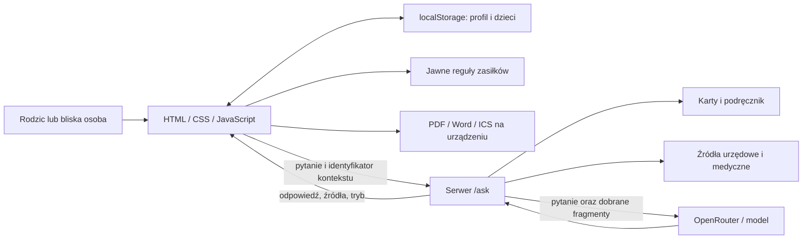

# Architektura i model danych

Otula składa się z frontendu statycznego oraz osobnego serwera odpowiedzi AI. Konto, baza rodzin i połączenia urzędowe nie są częścią obecnej architektury. Dane pokazowe są lokalną symulacją.

## Mapa kodu

| Plik | Odpowiedzialność |
| --- | --- |
| `otula/dist/index.html` | Kolejność ładowania skryptów, kontenery nawigacji i treści |
| `app.js` | Routing hash, stan, plan, szczegóły spraw, Karta wsparcia, podstawowy eksport |
| `catalog.js` | Katalog spraw, role, zatrudnienie, terminy i słowniczek |
| `family.js` | Profile dzieci, podręcznik, raport i interfejs asystenta |
| `assistant-panel.js`, `assistant-panel.css` | Kontekstowy panel AI na komputerze; na telefonie przejście do pełnego ekranu |
| `care.js` | Treści podręcznika wraz ze źródłami |
| `matching.js` | Dopasowanie tematów opieki; kopia synchronizowana do backendu |
| `calendar.js` | Własne terminy, widok miesiąca i ICS |
| `zus.js` | Reguły i widoki kalkulatora, e-usługi pokazowe, parametry |
| `report-export.js` | Eksport PDF/Word z lokalnymi bibliotekami |
| `icons.js`, `*.css`, `assets/` | Ikony, układ, ilustracje, fonty i biblioteki |
| `otula-asystent/worker/assistant.mjs` | Endpoint, źródła, model i odpowiedzi awaryjne |
| `discovery.mjs`, `medical-search.mjs` | Wyszukiwanie urzędowe i medyczne |
| `scripts/dev.mjs` | Lokalny adapter Node: frontend i API pod jednym originem |

Pliki frontendu są klasycznymi skryptami współdzielącymi zakres globalny. Kolejność z `index.html` jest częścią zależności. Nie wprowadzaj `type="module"` bez dostosowania importów i testów. Nie ma obowiązkowego bundlera ani procesu kompilacji interfejsu.

## Routing i zachowanie telefonu

Trasy mają postać `#start`, `#plan`, `#sprawa/<id>`, `#wsparcie/<id>`, `#terminy`, `#termin/<id>`, `#kalkulator`, `#konto-demo`, `#parametry`. Stan nawigacji pozwala wrócić z ekranu podrzędnego. Nie zastępuj tras oknami modalnymi: systemowe „wstecz” powinno zachować sens na telefonie. Sekwencja powitania nie pokazuje zakładek aplikacji przed ukończeniem wyborów.

## Dane lokalne

Na telefonie nawigacja jest rozwijana przyciskiem „Menu”, a na komputerze pozostaje w bocznym pasku. Asystent ma przycisk w rogu: od 1000 px otwiera niemodalny panel, poniżej pełną trasę `#pomoc`. Podczas powitania oba mechanizmy są ukryte. Zamknięcie panelu i menu przywraca fokus; systemowe cofanie nadal korzysta z tras.

Szkice kalkulatora są przechowywane tylko w pamięci bieżącej sesji, osobno według stabilnego UID dziecka. Zmiana danych istotnych dla obliczenia unieważnia szkic/wynik; usunięcie profilu czyści też te szkice. Nie są częścią trwałej historii świadczeń.

Klucz profilu to `otula-plan-v1` w `localStorage`. Historia przejść używa `otula-trail` w `sessionStorage`. Rola i praca należą do opiekuna. Lista `children` zawiera osobne plany, a `active` wybiera dziecko. Część pól aktywnego dziecka jest odzwierciedlana w stanie głównym dla zgodności z istniejącym interfejsem; `snapshotChild()` zapisuje je przed zmianą dziecka.

| Obiekt | Pola i znaczenie |
| --- | --- |
| Dziecko | `uid` stabilny identyfikator, `name`, `stage`, `date`, `done`, `extras`, `checks`, `note`, `multiple`, `events` |
| Własny termin | `id`, `title`, `date`, `time`, `remind`, `caseId`, `note`, `done`, `revision` |
| Parametry kalkulatora | Kopia `ZUS_DEFAULT_RULES` w pamięci sesji; bez trwałego panelu administracyjnego |

Daty są wartościami kalendarzowymi `YYYY-MM-DD`. Nie interpretuj terminu formalności jako uniwersalnej chwili UTC. Identyfikatory spraw są zapisane w postępie użytkownika — ich zmiana wymaga migracji. `uid` dziecka i `id` wydarzenia tworzą stabilny UID eksportu ICS. Edycja zwiększa `revision` używaną jako `SEQUENCE`.

## Serwer i konfiguracja

Build łączy JSON oraz źródła JS do `otula-asystent/dist/server/index.js`. Moduł eksportuje `fetch(Request, env)` i korzysta ze standardowych Web APIs. `env.OPENROUTER_API_KEY` jest przekazywany wyłącznie po stronie serwera. Pełny kontrakt: [ASYSTENT-AI.md](ASYSTENT-AI.md).

Lokalny adapter nie zmienia plików wdrożenia. Podczas serwowania `family.js` podmienia adres produkcyjnego `/ask` na lokalny, a do kopii workera w pamięci dopisuje dokładny origin loopback. Binduje tylko `127.0.0.1`; nie należy używać go jako serwera publicznego.

## Decyzje i koszty

- Frontend bez frameworka: prosty start, lokalne zasoby, mały zakres infrastruktury; kosztem są globalne zależności i większe pliki widoków.
- Dane na urządzeniu: mniej przekazywanych danych i natychmiastowy start; kosztem brak synchronizacji, kopii i wspólnego planu na różnych telefonach.
- Reguły poza AI: powtarzalne obliczenia i testy; nadal potrzebna kompletność prawna i aktualizacja parametrów.
- ICS: interoperacyjność bez konta i serwera powiadomień; kosztem import oraz brak synchronizacji.
- Osobny serwer AI: sekret nie jest publiczny; utrzymanie wymaga kontroli źródeł, kosztów, limitów i dostawców.
