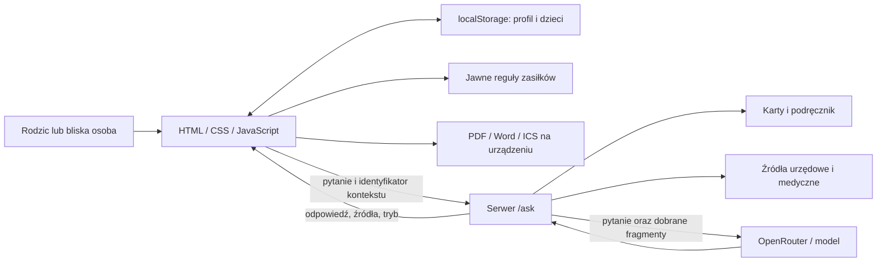

# Architektura i model danych

## Główna ścieżka rodzica

Router kieruje start do `#moja-sprawa`. Moduł `wywiad-reguly.js` wybiera pytania, odrzuca odpowiedzi z nieaktualnych odgałęzień i na tych samych danych wyznacza karty świadczeń. W module `wywiad-ui.js` pytanie, wynik i przygotowanie druku mają własne adresy hash. Adresy nie zawierają odpowiedzi rodziny. Klucz `otula-wywiad-v1` przechowuje odpowiedzi tylko po wybraniu zapisu. Wcześniejszy profil może podpowiedzieć rolę, etap, datę i zatrudnienie po wyborze importu.

Moduły `wniosek-pdf.js` i `chorobowe-pdf.js` wykorzystują lokalne wzory ZAM i ZAS-53. Wprowadzane do druków identyfikatory i rachunek pozostają w pamięci otwartego formularza. Podpis elektroniczny oraz wysyłka odbywają się po przejściu do właściwej usługi. Serwer asystenta nie bierze udziału w wywiadzie, ustalaniu kwot ani generowaniu PDF. Szczegóły generatora opisano w [dokumentacji ZAM](ZAM-PDF.md).

Otula składa się z frontendu statycznego oraz osobnego serwera odpowiedzi AI. Konto, baza rodzin i połączenia urzędowe nie są częścią obecnej architektury. Dane pokazowe są lokalną symulacją.

## Mapa kodu

| Plik | Odpowiedzialność |
| --- | --- |
| `otula/dist/index.html` | Kolejność ładowania skryptów, kontenery nawigacji i treści |
| `app.js` | Routing hash, stan, plan, szczegóły spraw, Karta wsparcia, podstawowy eksport |
| `catalog.js` | Katalog spraw, role, zatrudnienie, terminy i słowniczek |
| `family.js` | Profile dzieci, podręcznik, raport i interfejs asystenta |
| `assistant-panel.js`, `assistant-panel.css` | Kontekstowy panel AI na komputerze; na telefonie przejście do pełnego ekranu |
| `care.js` | Treści podręcznika wraz ze źródłami |
| `matching.js` | Dopasowanie tematów opieki; kopia synchronizowana do backendu |
| `calendar.js` | Własne terminy, widok miesiąca i ICS |
| `zus.js` | Reguły, oś dat i widoki kalkulatora, pomocnik hospitalizacji, minimalna podstawa, osobne podwyższenie miesięczne, parametry |
| `sprawy-zus.js`, `sprawy-zus-dane.js` | Lokalne rozpoznawanie oryginalnych PDF i zaszyfrowany katalog 86 unikalnych spraw |
| `report-export.js` | Eksport PDF/Word z lokalnymi bibliotekami |
| `icons.js`, `*.css`, `assets/` | Ikony, układ, ilustracje, fonty i biblioteki |
| `otula-asystent/worker/assistant.mjs` | Endpoint, źródła, model i odpowiedzi awaryjne |
| `discovery.mjs`, `medical-search.mjs` | Wyszukiwanie urzędowe i medyczne |
| `scripts/dev.mjs` | Lokalny adapter Node: frontend i API pod jednym originem |

Pliki frontendu są klasycznymi skryptami współdzielącymi zakres globalny. Kolejność z `index.html` jest częścią zależności. Nie wprowadzaj `type="module"` bez dostosowania importów i testów. Nie ma obowiązkowego bundlera ani procesu kompilacji interfejsu.

## Routing i zachowanie telefonu

Trasy mają postać `#start`, `#plan`, `#sprawa/<id>`, `#wsparcie/<id>`, `#terminy`, `#termin/<id>`, `#kalkulator`, `#sprawdz-sprawe`, `#e-uslugi/<usługa>` (dawne `#konto-demo` przekierowuje tutaj), `#uprawnienia`, `#parametry`. Stan nawigacji pozwala wrócić z ekranu podrzędnego. Nie zastępuj tras oknami modalnymi: systemowe „wstecz” powinno zachować sens na telefonie. Sekwencja powitania nie pokazuje zakładek aplikacji przed ukończeniem wyborów.

## Dane lokalne

Na telefonie nawigacja jest rozwijana przyciskiem „Menu”, a na komputerze pozostaje w bocznym pasku. Asystent ma przycisk w rogu: od 1000 px otwiera niemodalny panel, poniżej pełną trasę `#pomoc`. Podczas powitania oba mechanizmy są ukryte. Zamknięcie panelu i menu przywraca fokus; systemowe cofanie nadal korzysta z tras.

Własne szkice kalkulatora są zapisywane lokalnie w `otula-zus-drafts-v1`, osobno według stabilnego UID dziecka. Zmiana danych istotnych dla obliczenia unieważnia odpowiednie potwierdzenia/wynik; usunięcie profilu czyści też te szkice. Przykłady demonstracyjne pozostają tylko w pamięci i nie nadpisują własnego szkicu. To zapis roboczy na urządzeniu, bez synchronizacji i urzędowej historii świadczeń.

Klucz profilu to `otula-plan-v1` w `localStorage`. Historia przejść używa `otula-trail` w `sessionStorage`. Rola i praca należą do opiekuna. Lista `children` zawiera osobne plany, a `active` wybiera dziecko. Część pól aktywnego dziecka jest odzwierciedlana w stanie głównym dla zgodności z istniejącym interfejsem; `snapshotChild()` zapisuje je przed zmianą dziecka.

| Obiekt | Pola i znaczenie |
| --- | --- |
| Dziecko | `uid` stabilny identyfikator, `name`, `stage`, `date`, `done`, `extras`, `checks`, `note`, `multiple`, `events` |
| Własny termin | `id`, `title`, `date`, `time`, `remind`, `caseId`, `note`, `done`, `revision` |
| Parametry kalkulatora | `ZUS_DEFAULT_RULES` oraz lokalny zapis zatwierdzonej kopii pod `otula-zus-rules-v2`; schemat 2, walidacja, rok minimalnego wynagrodzenia oddzielony od wersji reguł, etykieta parametrów własnych i reset; bez kont administratorów i centralnego zatwierdzania |

Daty są wartościami kalendarzowymi `YYYY-MM-DD`. Nie interpretuj terminu formalności jako uniwersalnej chwili UTC. Identyfikatory spraw są zapisane w postępie użytkownika — ich zmiana wymaga migracji. `uid` dziecka i `id` wydarzenia tworzą stabilny UID eksportu ICS. Edycja zwiększa `revision` używaną jako `SEQUENCE`.

## Serwer i konfiguracja

Build łączy JSON oraz źródła JS do `otula-asystent/dist/server/index.js`. Moduł eksportuje `fetch(Request, env)` i korzysta ze standardowych Web APIs. `env.OPENROUTER_API_KEY` jest przekazywany wyłącznie po stronie serwera. Pełny kontrakt: [ASYSTENT-AI.md](ASYSTENT-AI.md).

Lokalny adapter nie zmienia plików wdrożenia. Podczas serwowania `family.js` podmienia adres produkcyjnego `/ask` na lokalny, a do kopii workera w pamięci dopisuje dokładny origin loopback. Binduje tylko `127.0.0.1`; nie należy używać go jako serwera publicznego.

## Decyzje i koszty

- Frontend bez frameworka: prosty start, lokalne zasoby, mały zakres infrastruktury; kosztem są globalne zależności i większe pliki widoków.
- Dane na urządzeniu: mniej przekazywanych danych i natychmiastowy start; kosztem brak synchronizacji, kopii i wspólnego planu na różnych telefonach.
- Reguły poza AI: powtarzalne obliczenia i testy; nadal potrzebna kompletność prawna i aktualizacja parametrów.
- ICS: interoperacyjność bez konta i serwera powiadomień; kosztem import oraz brak synchronizacji.
- Osobny serwer AI: sekret nie jest publiczny; utrzymanie wymaga kontroli źródeł, kosztów, limitów i dostawców.

## Moduły dodane 21.11.2026 (wieczór)

| Plik | Rola |
| --- | --- |
| `otula/dist/e-uslugi.js`, `e-uslugi.css` | Centrum e-usług domyślnie pokazuje wspólny profil rodziny i kieruje do jednej edycji `#sytuacja`, świadczeń, własnego wyliczenia oraz oficjalnego eZUS. Osobne rozwinięcie zawiera pokaz mObywatel, pobierania danych, zaświadczeń i wniosków. Trzy fikcyjne osoby mają odrębne daty; `zusOpenExample` przenosi je do oznaczonego przykładu bez zmiany danych rodziny. |
| `otula/dist/sprawy-zus.js`, `sprawy-zus.css` | „Sprawdź sprawę ZUS”: PDF → SHA-256 w przeglądarce → odszyfrowanie opracowanego wcześniej opisu. Pokazuje fakty, strony źródłowe, stan odczytu oraz oddziela okresy wniosku od rozstrzygniętych. `nieustalona` nie zmienia się domyślnie w przyznanie. Porównanie działa tylko dla dostępnych danych; obecny katalog nie ma zweryfikowanych kwot. Ta sama funkcja działa w teczce kalkulatora. |
| `otula/dist/sprawy-zus-dane.js` | Wyłącznie szyfrogram AES-GCM. Klucz i indeks wyprowadzone z SHA-256 oryginalnego PDF; bez pliku danych nie da się odczytać. Generuje `scripts/sprawy-zus/zaszyfruj.mjs`. |
| `otula/dist/ui-czytelnosc.css` | Jednolite sekcje rozwijane (karta z przyciskiem +/– zamiast trójkąta ▶), minimalne rozmiary krojów, kompaktowy przycisk asystenta na telefonie. |
| `otula/tests/sprawy.test.cjs` | Szyfrowanie, odrzucenie obcego/zmienionego pliku, duplikatu i brakującego źródła, brak jawnych danych, 86 rekordów oraz brak domyślnego przyznania przy nieustalonym wyniku. |

## Katalog spraw: rozpoznanie a walidacja

Zestaw 87 PDF zawiera jedną identyczną bajtowo kopię, czyli 86 unikalnych spraw. Katalog zachowuje rozpoznawanie wcześniejszych 10 i dodaje 76. Agregaty: 57 częściowych odczytów decyzji/adnotacji o wyniku, 29 rozstrzygnięć nieustalonych, 0 zweryfikowanych kwot. Nie jest to automatyczna analiza nowego PDF ani 86 pełnych testów prawidłowości kalkulatora.

Jawny JSON, OCR, mapowanie plików i audyt skrótów PDF/OCR pozostają lokalnie poza repozytorium. Do aplikacji trafia wyłącznie AES-GCM oraz niesensytywne agregaty. `zaszyfruj.mjs` nie zapisuje katalogu, jeżeli brakuje PDF, występuje identyczny duplikat albo sprzeczny status. Nazwa PDF jest usuwana z szyfrowanego opisu. Każdy opis ma anonimowy `id`, `walidacja` i `zrodla` ze stronami; nieustalone okresy wniosku mają osobne pole `wnioskowaneOkresy`.

Plik wybrany w przeglądarce pozostaje na urządzeniu; nie trafia do `/ask`, OpenRouter ani usługi OCR. Skrót pliku wyznacza indeks i klucz AES-GCM. To ograniczenie dostępu do przygotowanego katalogu na potrzeby demo, nie system kont ani produkcyjna autoryzacja. Posiadacz oryginalnego PDF może odczytać odpowiadający mu opis. [Dokładny zakres dowodów](WALIDACJA-ZUS.md).
