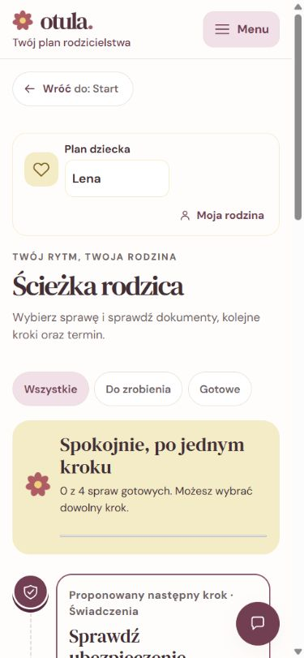
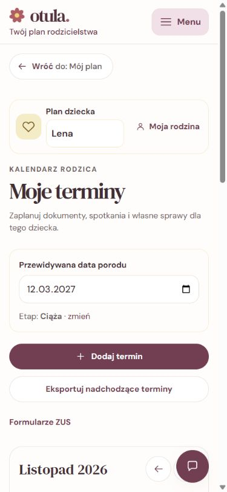
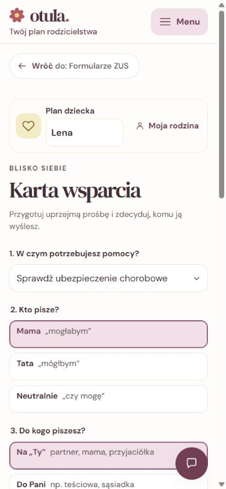
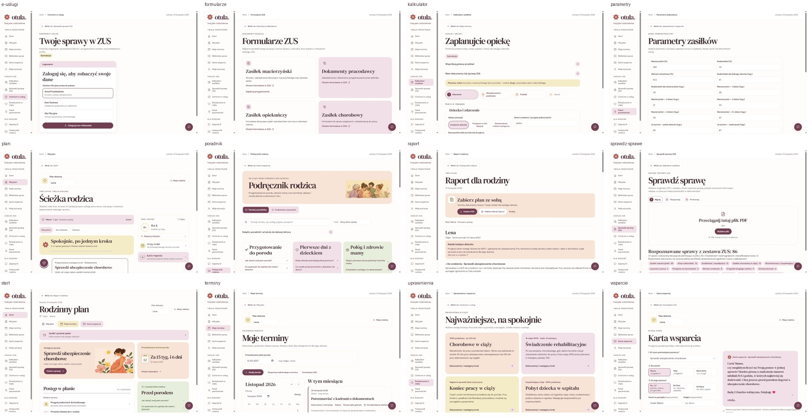

# Aktualne ekrany Otuli

Zrzuty z audytu interfejsu z 21.11.2026 pokazują fikcyjne dane i wspólny styl opisany w [STYL-I-DESIGN.md](STYL-I-DESIGN.md). Zestaw obejmuje **12 tras w szerokościach 320, 390 i 1440 px — 36 widoków**. Nie są to wizualizacje planowanego produktu, lecz ekrany działającej aplikacji.

[Zapis audytu](../otula/materialy/zrzuty-final/audit-after.json) zawiera nagłówki, stan powrotu i wymiary strony. W tych widokach nie stwierdzono poziomego przepełnienia. Zrzuty nie zastępują sprawdzenia wszystkich interakcji ani audytu dostępności.

## Plan, terminy i Karta wsparcia na telefonie

| Plan | Moje terminy | Karta wsparcia |
| --- | --- | --- |
|  |  |  |

## Wszystkie widoki

Każdy odnośnik otwiera pełny zrzut. Nazwy plików: `audit-<szerokość>-<trasa>.jpg` w `otula/materialy/zrzuty-final`.

| Ekran | Telefon 320 px | Telefon 390 px | Komputer 1440 px |
| --- | --- | --- | --- |
| Rodzinny plan | [320 px](../otula/materialy/zrzuty-final/audit-320-start.jpg) | [390 px](../otula/materialy/zrzuty-final/audit-390-start.jpg) | [1440 px](../otula/materialy/zrzuty-final/audit-1440-start.jpg) |
| Ścieżka rodzica | [320 px](../otula/materialy/zrzuty-final/audit-320-plan.jpg) | [390 px](../otula/materialy/zrzuty-final/audit-390-plan.jpg) | [1440 px](../otula/materialy/zrzuty-final/audit-1440-plan.jpg) |
| Moje terminy | [320 px](../otula/materialy/zrzuty-final/audit-320-terminy.jpg) | [390 px](../otula/materialy/zrzuty-final/audit-390-terminy.jpg) | [1440 px](../otula/materialy/zrzuty-final/audit-1440-terminy.jpg) |
| Kalkulator | [320 px](../otula/materialy/zrzuty-final/audit-320-kalkulator.jpg) | [390 px](../otula/materialy/zrzuty-final/audit-390-kalkulator.jpg) | [1440 px](../otula/materialy/zrzuty-final/audit-1440-kalkulator.jpg) |
| Sprawdź sprawę ZUS | [320 px](../otula/materialy/zrzuty-final/audit-320-sprawdz-sprawe.jpg) | [390 px](../otula/materialy/zrzuty-final/audit-390-sprawdz-sprawe.jpg) | [1440 px](../otula/materialy/zrzuty-final/audit-1440-sprawdz-sprawe.jpg) |
| Centrum e-usług | [320 px](../otula/materialy/zrzuty-final/audit-320-e-uslugi.jpg) | [390 px](../otula/materialy/zrzuty-final/audit-390-e-uslugi.jpg) | [1440 px](../otula/materialy/zrzuty-final/audit-1440-e-uslugi.jpg) |
| Uprawnienia | [320 px](../otula/materialy/zrzuty-final/audit-320-uprawnienia.jpg) | [390 px](../otula/materialy/zrzuty-final/audit-390-uprawnienia.jpg) | [1440 px](../otula/materialy/zrzuty-final/audit-1440-uprawnienia.jpg) |
| Parametry | [320 px](../otula/materialy/zrzuty-final/audit-320-parametry.jpg) | [390 px](../otula/materialy/zrzuty-final/audit-390-parametry.jpg) | [1440 px](../otula/materialy/zrzuty-final/audit-1440-parametry.jpg) |
| Formularze | [320 px](../otula/materialy/zrzuty-final/audit-320-formularze.jpg) | [390 px](../otula/materialy/zrzuty-final/audit-390-formularze.jpg) | [1440 px](../otula/materialy/zrzuty-final/audit-1440-formularze.jpg) |
| Podręcznik | [320 px](../otula/materialy/zrzuty-final/audit-320-poradnik.jpg) | [390 px](../otula/materialy/zrzuty-final/audit-390-poradnik.jpg) | [1440 px](../otula/materialy/zrzuty-final/audit-1440-poradnik.jpg) |
| Karta wsparcia | [320 px](../otula/materialy/zrzuty-final/audit-320-wsparcie.jpg) | [390 px](../otula/materialy/zrzuty-final/audit-390-wsparcie.jpg) | [1440 px](../otula/materialy/zrzuty-final/audit-1440-wsparcie.jpg) |
| Raport | [320 px](../otula/materialy/zrzuty-final/audit-320-raport.jpg) | [390 px](../otula/materialy/zrzuty-final/audit-390-raport.jpg) | [1440 px](../otula/materialy/zrzuty-final/audit-1440-raport.jpg) |

## Przegląd na komputerze

[Plansza telefon 320 px](../otula/materialy/zrzuty-final/contact-320.jpg) · [plansza telefon 390 px](../otula/materialy/zrzuty-final/contact-390.jpg).

Do slajdów i filmu wykorzystano dodatkowe ujęcia o nazwach `web-*` i `phone-*` w tym samym katalogu. Rzeczywiste ekrany są kadrowane z zachowaniem proporcji; źródła montażu są w [materiałach dla jury](../otula/materialy/jury/README.md). Starszy folder `zrzuty-21-11` pozostaje materiałem historycznym i nie jest główną galerią bieżącej wersji.
