# Otula+ — wymagania wyzwania a nasza realizacja

**Wyzwanie:** Zasiłkowy Przewodnik Przyszłego Rodzica (ZUS, HackNation 2026)  
**Zespół:** Łukasz Łapiak, Patrycja Wołowicz, Filip Czerwiński — Uniwersytet Kazimierza Wielkiego w Bydgoszczy  
**Repozytorium:** https://github.com/Wolowicz/Zasilkowy-Przewodnik-Przyszlego-Rodzica

Treść wyzwania przeczytaliśmy kilka razy i rozpisaliśmy ją na listę kontrolną. W tym dokumencie przechodzimy przez nią punkt po punkcie. Przy każdym wymaganiu podajemy, czego oczekiwał ZUS, jak to zrobiliśmy, gdzie to znaleźć w aplikacji, i dokładamy zrzut ekranu.

Wynik oznaczamy tak jak w testach akceptacyjnych. **PASS** znaczy, że wymaganie jest uwzględnione w aplikacji. Część funkcji brief kazał tylko zasymulować (mObywatel, dane z ZUS, e-ZLA, PUE/eZUS, USC). W takich miejscach działa symulacja przez nasze REST API, a w opisie piszemy, co trzeba podmienić, żeby podłączyć prawdziwą usługę.

Osoby na zrzutach są fikcyjne: rodzina testowa Anna i Piotr Kowalscy oraz siedem spraw testowych w Audytorze.

---

## Podsumowanie

| Nr | Wymaganie z treści wyzwania | Gdzie w aplikacji | Wynik |
|---|---|---|---|
| **A** | **Co narzędzie ma zapewnić (pkt 3, lista a–j)** | | |
| A1 | a) Świadczenia w czasie ciąży, także brak uprawnień | Plan, Kalkulator, e-Usługi, asystent | **PASS** |
| A2 | b) Kalkulator dla obojga rodziców (liczba dzieci, wiek, „Za życiem”) | Kalkulator | **PASS** |
| A3 | c) Łączenie pracy z urlopem rodzicielskim | Kalkulator, Plan | **PASS** |
| A4 | d) Symulacja, gdy z urlopu korzystają oboje rodzice | Kalkulator, Plan | **PASS** |
| A5 | e), j) Rodzice adopcyjni i rodzina zastępcza niezawodowa | Kalkulator | **PASS** |
| A6 | f) Indywidualna podstawa wymiaru, sprawy z zestawów | Audytor PDF, Kalkulator | **PASS** |
| A7 | g) Dokumenty, terminy, pracodawca czy ZUS | Dokumenty i wnioski, Plan | **PASS** |
| A8 | h) Zagrożenia i ryzyka utraty albo obniżenia świadczeń | Kalkulator, Audytor | **PASS** |
| A9 | i) Organizacje o charakterze charytatywnym | Trudne sytuacje | **PASS** |
| A10 | Rekomendacja: jeden zintegrowany kalkulator | Kalkulator | **PASS** |
| **B** | **Możliwości narzędzia (pkt 3, druga lista)** | | |
| B1 | Logowanie przez mObywatela (symulacja) | Nagłówek, e-Usługi | **PASS** |
| B2 | Pobranie danych z ZUS albo wpisanie ich samodzielnie | e-Usługi, Kreator | **PASS** |
| B3 | Zadłużenie składkowe na dzień powstania prawa | e-Usługi | **PASS** |
| B4 | Podgląd zaświadczeń e-ZLA | e-Usługi, Plan | **PASS** |
| B5 | Połączenie z PUE/eZUS (pytanie, podgląd danych) | e-Usługi, Audytor | **PASS** |
| B6 | Wnioski o urlopy i świadczenia, przesłanie do pracodawcy lub ZUS | Dokumenty i wnioski | **PASS** |
| B7 | Wniosek o odpis aktu urodzenia (USC) | e-Usługi | **PASS** |
| B8 | Informacje o podmiotach wsparcia (fundacje, stowarzyszenia) | Trudne sytuacje | **PASS** |
| B9 | Przekierowania do zus.pl, gov.pl (MRPiPS) i PIP | Baza wiedzy, stopka | **PASS** |
| B10 | Panel administracyjny do zmiany parametrów | Parametry Admin | **PASS** |
| **C** | **Wymagania techniczne i sposób testowania (pkt 5–6)** | | |
| C1 | Aplikacja webowa w architekturze RWD | Cała aplikacja | **PASS** |
| C2 | React po stronie frontu, JavaScript na backendzie, REST API | Kod | **PASS** |
| C3 | Potencjał wdrożenia produkcyjnego | Architektura | **PASS** |
| C4 | Upload albo wybór wniosków na stronie | Audytor PDF | **PASS** |
| C5 | Poprawność wyliczeń na przykładach | Silnik reguł, testy | **PASS** |
| **D** | **Wymagania formalne (pkt 4)** | | |
| D1 | Tytuł i szczegółowy opis projektu | README, opis, ten dokument | **PASS** |
| D2 | Prezentacja, maksymalnie 10 slajdów | 9 slajdów | **PASS** |
| D3 | Film, maksymalnie 3 minuty | 2:52 | **PASS** |
| D4 | Repozytorium kodu | GitHub | **PASS** |
| D5 | Zrzuty ekranu | `docs/img`, prezentacja | **PASS** |
| D6 | Demo jako strona internetowa z testem przykładów | Aplikacja, Audytor | **PASS** |
| D7 | Pełna responsywność | Telefon, tablet, laptop | **PASS** |
| D8 | Materiały graficzne | Logo, plakat, prezentacja | **PASS** |
| D9 | Wskazanie funkcji opartych na AI | Baza wiedzy, README, oznaczenia w UI | **PASS** |
| **E** | **Sytuacje z opisu problemu (bez osobnej litery)** | | |
| E1 | Martwe urodzenie, wcześniak, ciężka choroba dziecka, choroba lub śmierć matki | Trudne sytuacje, Kalkulator | **PASS** |
| E2 | Szczególna ochrona pracownic i pracowników (Kodeks pracy) | Plan, ryzyka | **PASS** |
| E3 | Zmiany formularzy od 24.10.2026 (ZUR i ZAO włączone do ZAM) | Dokumenty i wnioski | **PASS** |

**Wynik: 37 z 37 wymagań — PASS.**

---

## A. Co narzędzie ma zapewnić

### A1. Świadczenia w czasie ciąży, także brak uprawnień — PASS

**W zadaniu:** informacja o zasiłku chorobowym, świadczeniu rehabilitacyjnym i zasiłku w wysokości zasiłku macierzyńskiego. Narzędzie ma też mówić wprost, kiedy świadczenie nie przysługuje.

**Jak to rozwiązaliśmy:**

- Plan rodziny zaczyna się od etapu „Ciąża i ochrona pracownicza”. Widać tam zwolnienia e-ZLA z kodem „B” (100% podstawy) i licznik wykorzystanych dni z 270-dniowego okresu zasiłkowego.
- Przy zwolnieniach wyjaśniamy, że po wyczerpaniu okresu zasiłkowego przysługuje świadczenie rehabilitacyjne. To samo podaje asystent „Zapytaj Otulę”, razem z podstawą prawną.
- W kalkulatorze jest opcja „Likwidacja pracodawcy — umowa rozwiązana w ciąży”. Otula liczy wtedy zasiłek w wysokości zasiłku macierzyńskiego do dnia porodu (art. 30 ust. 3 ustawy zasiłkowej) i wskazuje, że wypłaca go ZUS.
- Przy wyborze „Brak ubezpieczenia” Otula mówi jasno, że zasiłek macierzyński z ZUS nie przysługuje. Kieruje wtedy do świadczenia rodzicielskiego 1000 zł z gminy.
- Pilnujemy okresu wyczekiwania: 30 dni przy ubezpieczeniu obowiązkowym i 90 dni przy dobrowolnym.

**Gdzie sprawdzić:** Plan i Oś Czasu → karta „Zwolnienie e-ZLA (kod B)”; Symulacje e-Usług → „Zaświadczenia lekarskie”; Kalkulator → „Jak jesteś ubezpieczona w dniu porodu?”.

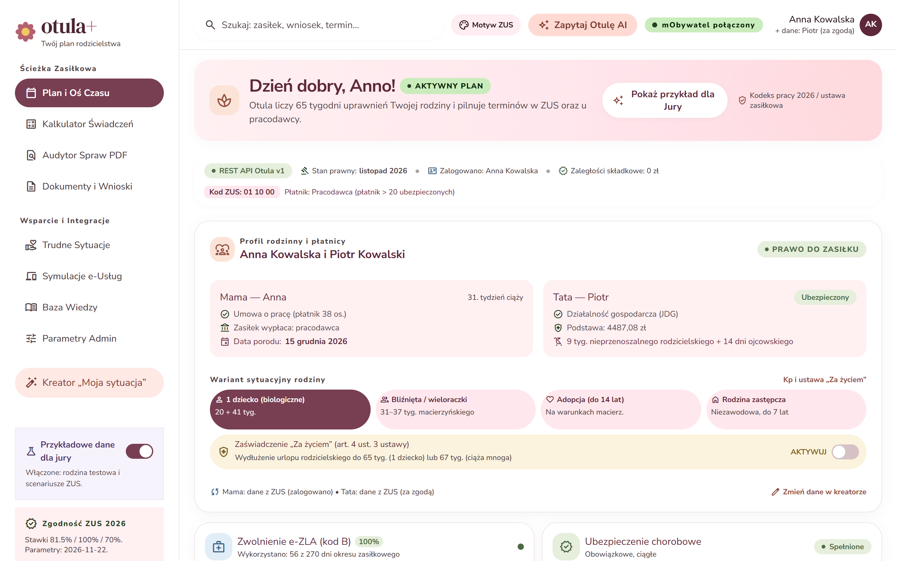

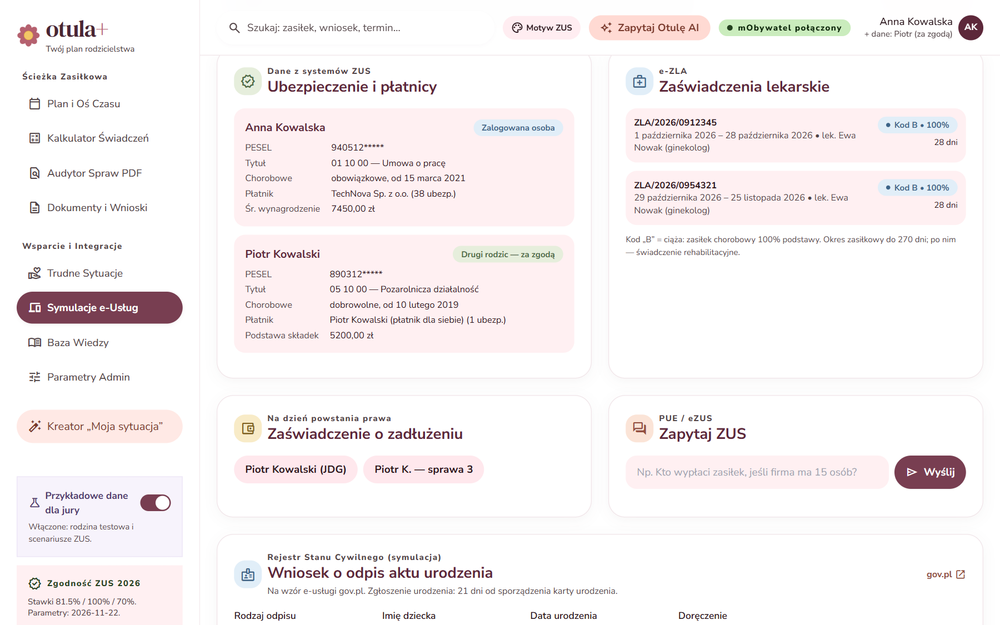

### A2. Kalkulator dla obojga rodziców — PASS

**W zadaniu:** okres trwania i wysokość zasiłku dla obojga rodziców, z uwzględnieniem wszystkich okoliczności, np. liczby dzieci, ich wieku i zaświadczenia „Za życiem”.

**Jak to rozwiązaliśmy:**

- Liczba dzieci przy jednym porodzie (1–5) zmienia wymiar macierzyńskiego: 20, 31, 33, 35 lub 37 tygodni. Rodzicielski ma 41 albo 43 tygodnie.
- Zaświadczenie „Za życiem” wydłuża rodzicielski do 65 lub 67 tygodni.
- Uwzględniamy też wcześniaka i hospitalizację noworodka (urlop uzupełniający do 8 albo 15 tygodni) oraz urodzenie martwego dziecka.
- Podstawę liczymy ze średniego wynagrodzenia z 12 miesięcy minus 13,71% składek. Można też wpisać gotową podstawę z zaświadczenia Z-3.
- Wynik to harmonogram z datami, stawką, kwotą brutto i netto oraz informacją, kto wypłaca każdą część.

**Gdzie sprawdzić:** Kalkulator Świadczeń.

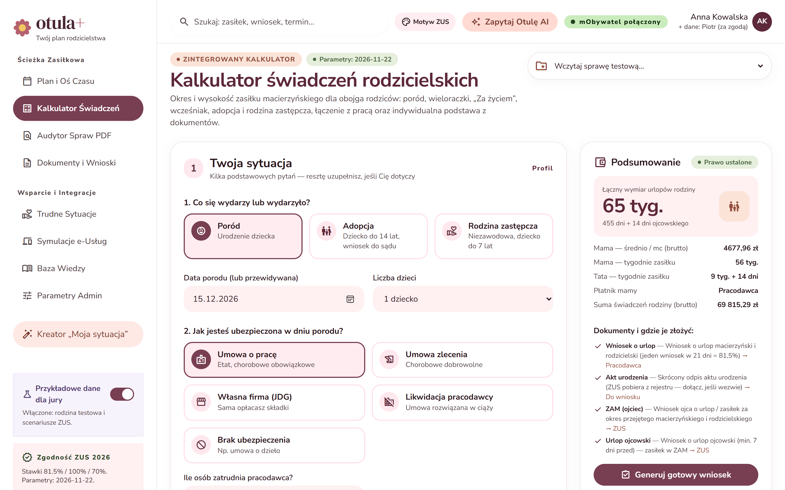

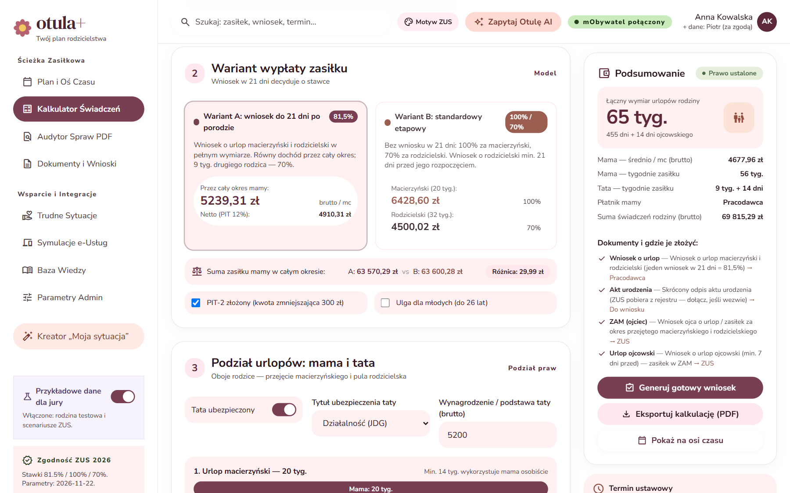

### A3. Łączenie pracy z urlopem rodzicielskim — PASS

**W zadaniu:** kalkulator okresu i wysokości zasiłku, gdy rodzic pracuje w trakcie urlopu rodzicielskiego.

**Jak to rozwiązaliśmy:** rodzic wybiera wymiar pracy (do 1/2 etatu) i liczbę tygodni. Otula liczy proporcjonalne wydłużenie urlopu, wynagrodzenie, zmniejszony zasiłek i łączny dochód miesięczny. Przykład ze zrzutu: 8 tygodni na pół etatu wydłuża urlop o 4 tygodnie. Rodzic dostaje wtedy 3 725,00 zł pensji i 2 619,66 zł zasiłku, czyli 6 344,66 zł brutto miesięcznie. Ten sam symulator jest na ekranie planu jako „Co jeśli?”, a w Audytorze jest gotowa sprawa testowa nr 7.

**Gdzie sprawdzić:** Kalkulator → „Łączenie urlopu rodzicielskiego z pracą”; Plan i Oś Czasu → ta sama sekcja.

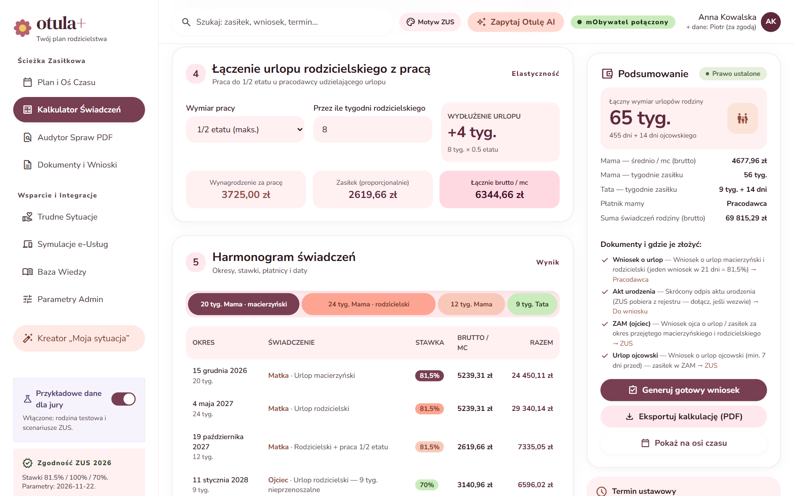

### A4. Oboje rodzice korzystają z urlopu — PASS

**W zadaniu:** symulacja okresu i wysokości zasiłku, gdy z uprawnień chcą skorzystać oboje rodzice.

**Jak to rozwiązaliśmy:**

- W sekcji „Podział urlopów: mama i tata” rodzice ustawiają, kto i ile bierze.
- Ojciec może przejąć część macierzyńskiego po obowiązkowych 14 tygodniach.
- Każdy rodzic ma 9 nieprzenoszalnych tygodni rodzicielskiego płatnych 70%, niezależnie od wariantu.
- Ojciec ma osobne 14 dni urlopu ojcowskiego.
- Dla każdego z rodziców wskazujemy osobnego płatnika. W rodzinie testowej mamie wypłaca pracodawca, a tacie na JDG — ZUS.
- Plan pokazuje oba urlopy na jednej osi czasu.

**Gdzie sprawdzić:** Kalkulator → „Podział urlopów: mama i tata” i „Harmonogram świadczeń”; Plan i Oś Czasu.

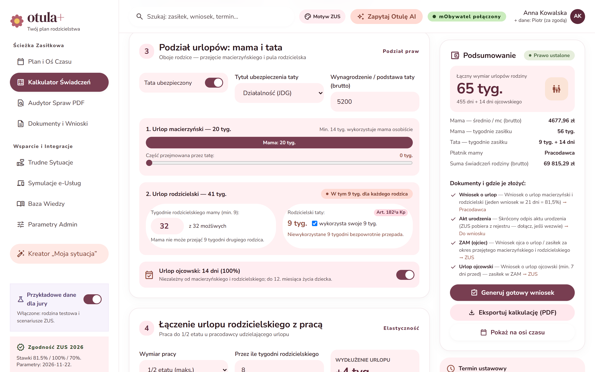

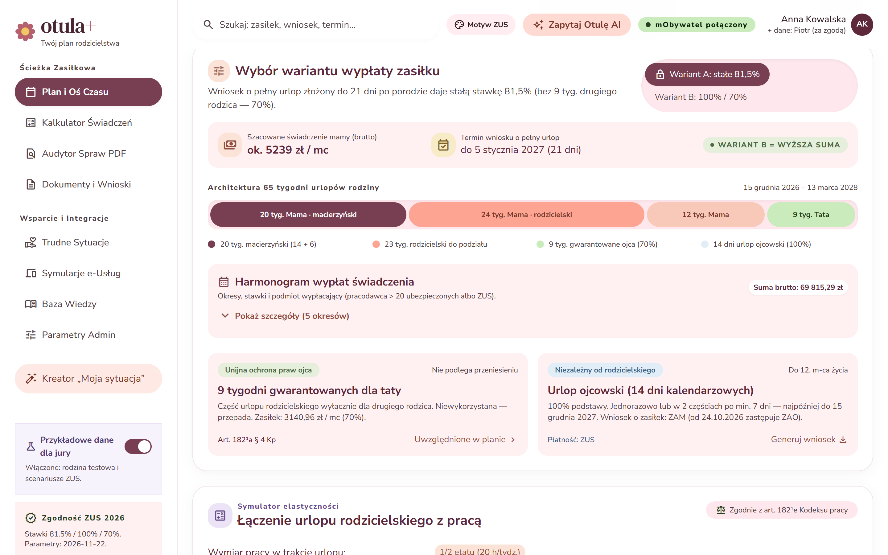

### A5. Rodzice adopcyjni i rodzina zastępcza niezawodowa — PASS

**W zadaniu:** kalkulator dla rodziców adopcyjnych i rodzin zastępczych (punkty e oraz j).

**Jak to rozwiązaliśmy:** w kalkulatorze wybiera się zdarzenie „Poród”, „Adopcja” albo „Rodzina zastępcza”. Przy adopcji obowiązuje limit wieku dziecka 14 lat. Przy rodzinie zastępczej niezawodowej limit to 7 lat, a przy odroczonym obowiązku szkolnym 10 lat. Wymiar liczymy od dnia przyjęcia dziecka, nie krócej niż 9 tygodni. Nie ma obowiązkowych 14 tygodni dla matki, a wniosek o 81,5% składa się w ciągu 21 dni od przyjęcia dziecka. Lista dokumentów sama zmienia się na postanowienie sądu albo umowę o pełnienie funkcji rodziny zastępczej.

**Gdzie sprawdzić:** Kalkulator → „Co się wydarzy lub wydarzyło?”; Audytor → sprawa testowa nr 6 (przysposobienie dziecka w wieku 3 lat).

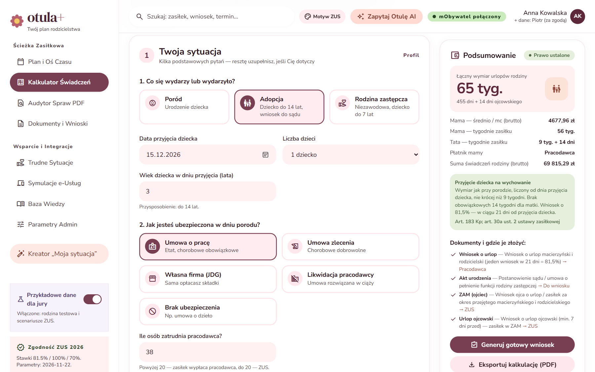

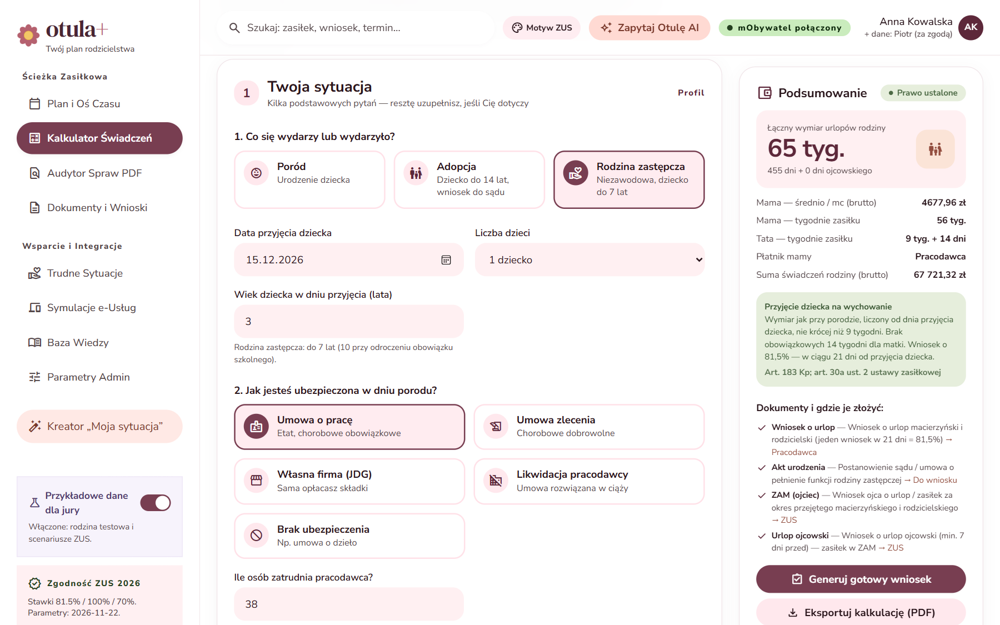

### A6. Indywidualna podstawa wymiaru i sprawy z zestawów — PASS

**W zadaniu:** wyliczenie zasiłku dla konkretnej sprawy z zestawów udostępnionych przez ZUS, z indywidualną podstawą wymiaru.

**Jak to rozwiązaliśmy:**

- Zbudowaliśmy Audytor spraw PDF. Można wgrać dokument z zestawu (ZAM, Z-3, Z-3a, ZAS-53, ZAS-12, decyzja) albo kliknąć jedną z siedmiu spraw testowych.
- Gdy PDF ma warstwę tekstową, czytamy ją bezpośrednio. Skany odczytuje OCR z modelem języka polskiego, w całości w przeglądarce.
- Odczytane dane trafiają do silnika reguł, który sprawdza:
  - kod tytułu ubezpieczenia,
  - podstawę wymiaru,
  - termin 21 dni,
  - płatnika,
  - ryzyka.

- Raport zestawia trzy kolumny: wartość z dokumentu, wyliczenie Otuli i status według przepisów.

**Gdzie sprawdzić:** Audytor Spraw PDF.

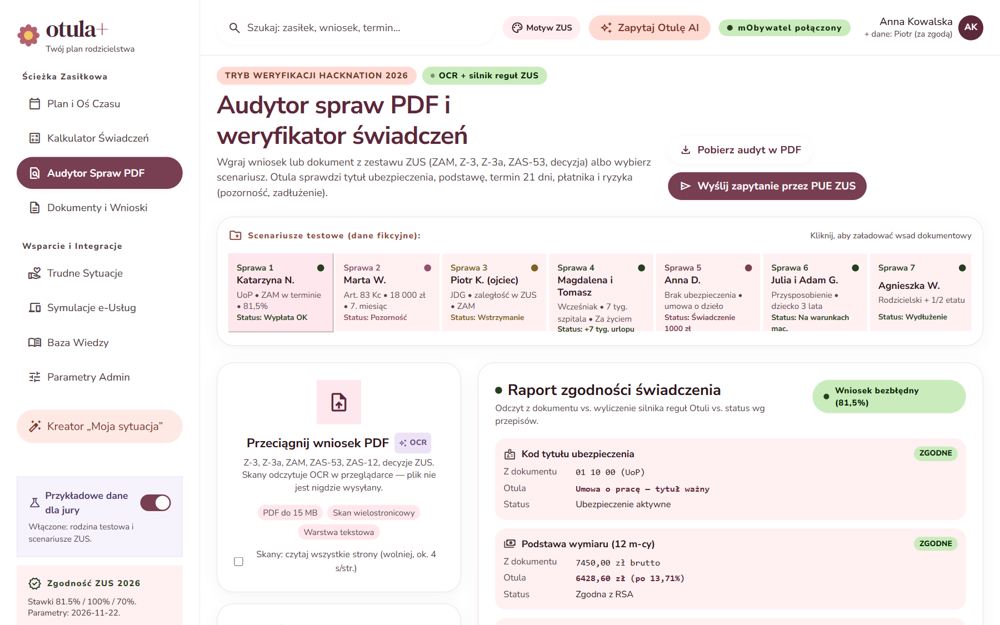

### A7. Dokumenty, terminy i miejsce złożenia — PASS

**W zadaniu:** informacja o dokumentach, terminach i sposobie złożenia wniosków, z uwzględnieniem, że zasiłek wypłaca pracodawca albo ZUS.

**Jak to rozwiązaliśmy:**

- Płatnika ustalamy według art. 61 ustawy zasiłkowej. Jeśli pracodawca zgłasza do ubezpieczenia chorobowego ponad 20 osób (stan na 30 listopada), zasiłek wypłaca on. W pozostałych przypadkach wypłaca ZUS.
- Przy każdym dokumencie jest strzałka, dokąd go zanieść: „→ Pracodawca”, „→ ZUS” albo „→ Do wniosku”.
- Terminy mają konkretne daty, np. wniosek o 81,5% do 5 stycznia 2027 r. dla porodu 15 grudnia 2026 r.
- Terminy można jednym kliknięciem dodać do kalendarza w telefonie (plik .ics).

**Gdzie sprawdzić:** Dokumenty i Wnioski; Plan i Oś Czasu → „Najbliższe kroki proceduralne”.

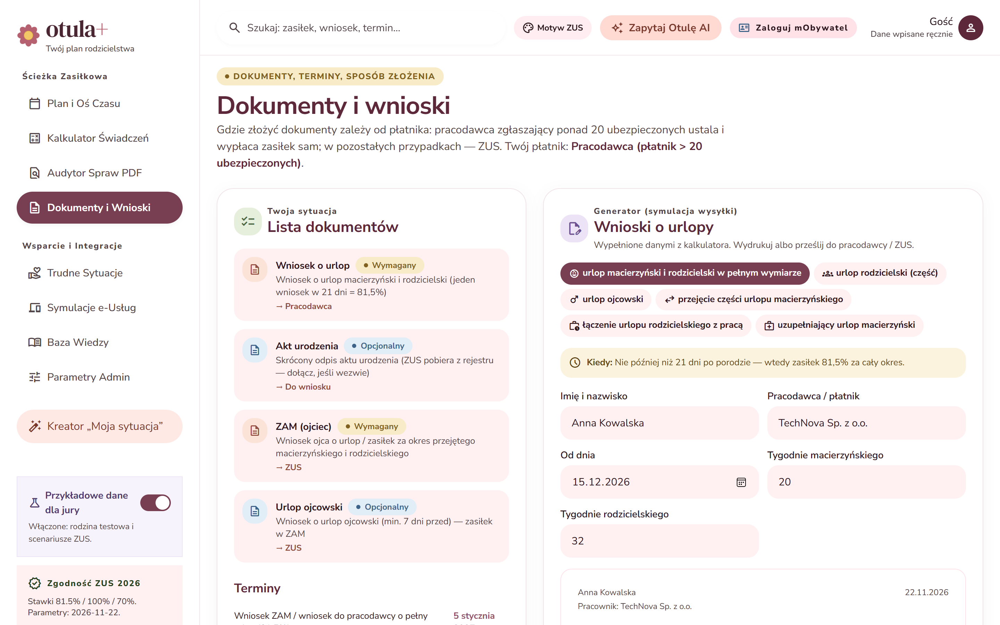

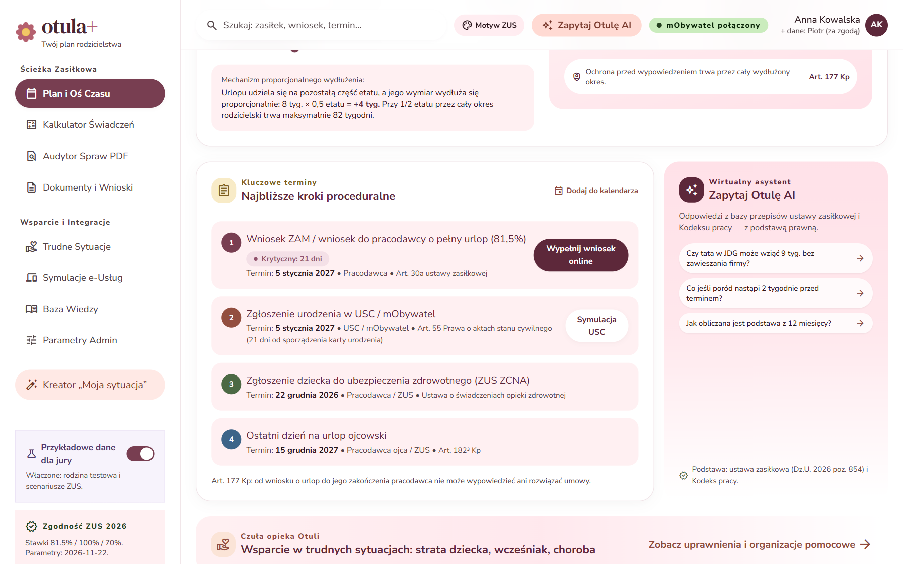

### A8. Zagrożenia i ryzyka — PASS

**W zadaniu:** informacja o zagrożeniach związanych z utratą uprawnień albo zmianą wymiaru i wysokości świadczeń.

**Jak to rozwiązaliśmy:** silnik ma osobną listę ryzyk i sam podświetla te, które pasują do sytuacji rodziny:

- umowa zawarta dla pozoru (art. 83 Kc),
- podwyższenie podstawy wymiaru w ciąży,
- brak ubezpieczenia w dniu porodu (np. koniec zlecenia albo wyrejestrowanie z dobrowolnego chorobowego),
- przekroczenie 21 dni,
- zadłużenie składkowe przy JDG (art. 2a),
- praca zarobkowa w czasie zasiłku.

Ryzyka pokazujemy w kalkulatorze i w raporcie Audytora. Sprawa testowa nr 2 (Marta W.) pokazuje zarzut pozorności, a sprawa nr 3 (Piotr K.) wstrzymanie wypłaty z powodu zaległości w ZUS.

**Gdzie sprawdzić:** Kalkulator → ryzyka; Audytor → sprawy nr 2 i 3.

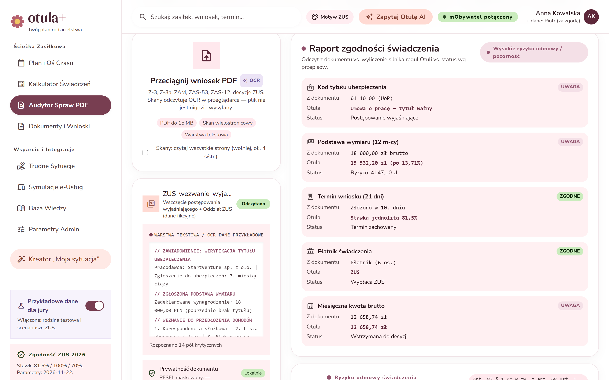

### A9. Organizacje o charakterze charytatywnym — PASS

**W zadaniu:** informacja o podmiotach wyłącznie charytatywnych, które pomagają w sytuacjach takich jak śmierć dziecka, przedwczesny poród, poronienie czy ciężka choroba dziecka.

**Jak to rozwiązaliśmy:** na ekranie „Trudne sytuacje” zebraliśmy sześć organizacji z opisem i linkiem:

- Fundacja Koalicja dla Wcześniaka,
- Stowarzyszenie Rodziców po Poronieniu,
- Fundacja Gajusz (hospicjum perinatalne),
- Warszawskie Hospicjum dla Dzieci,
- Fundacja Rodzić po Ludzku,
- Fundacja Hospicyjna.

Listę można filtrować według sytuacji. Obok są numery wsparcia telefonicznego: 116 123, 800 70 2222 i infolinia ZUS.

**Gdzie sprawdzić:** Trudne Sytuacje → „Fundacje i stowarzyszenia wspierające rodziców”.

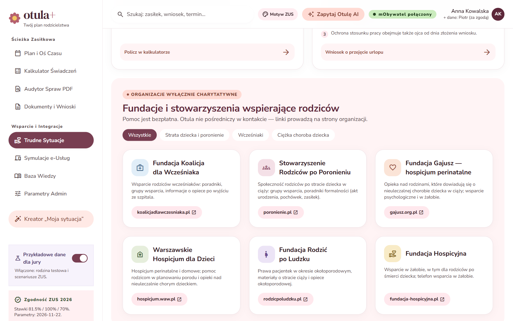

### A10. Jeden zintegrowany kalkulator — PASS

**W zadaniu:** ZUS rekomenduje, żeby wszystkie kalkulatory były jednym narzędziem z wyborem opcji.

**Jak to rozwiązaliśmy:** mamy jeden kalkulator zamiast kilku osobnych. Najpierw wybiera się zdarzenie (poród, adopcja, rodzina zastępcza) i formę ubezpieczenia. Potem w miarę potrzeby dochodzą kolejne sekcje: wariant wypłaty, podział między rodziców i łączenie z pracą. Na końcu jest harmonogram. Podsumowanie po prawej stronie przelicza się od razu po każdej zmianie.

**Gdzie sprawdzić:** Kalkulator Świadczeń (zrzuty przy A2–A5).

---

## B. Możliwości narzędzia

### B1. Logowanie przez mObywatela — PASS (symulacja)

**W zadaniu:** zasymulować logowanie przez mObywatela.

**Jak to rozwiązaliśmy:** logowanie odwzorowuje przebieg z kodem QR i ekranem zgód. Zawsze loguje się jedna osoba. Dane drugiego rodzica pojawiają się dopiero wtedy, gdy wyrazi zgodę w swojej aplikacji (to też symulujemy). W nagłówku widać „mObywatel połączony” i od kogo pochodzą dane.

**Podłączenie prawdziwej usługi:** logowanie obsługuje endpoint `POST /api/demo/login`. Wystarczy go zastąpić integracją z Węzłem Krajowym (login.gov.pl). Interfejs zostaje bez zmian.

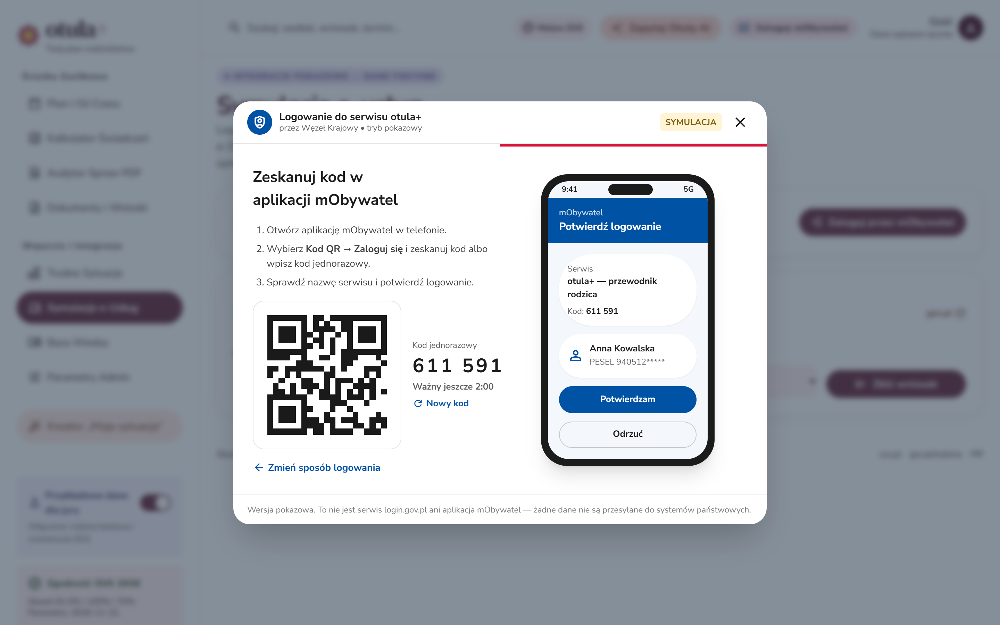

### B2. Dane z ZUS albo wpisane samodzielnie — PASS (symulacja)

**W zadaniu:** zasymulować pobranie z ZUS danych o ubezpieczeniu albo jego braku. Dać też możliwość wpisania danych samodzielnie.

**Jak to rozwiązaliśmy:** po zalogowaniu Otula pokazuje dla obojga rodziców tytuł ubezpieczenia z kodem (np. 01 10 00), rodzaj chorobowego, płatnika, liczbę ubezpieczonych i wynagrodzenie. PESEL jest maskowany. Kto nie chce się logować, przechodzi kreator „Moja sytuacja”: siedem kroków, przy każdym przycisk „Nie wiem, co to oznacza?”.

**Podłączenie prawdziwej usługi:** dane zwraca `GET /api/demo/profile`. W miejsce danych testowych podpinamy API ZUS.

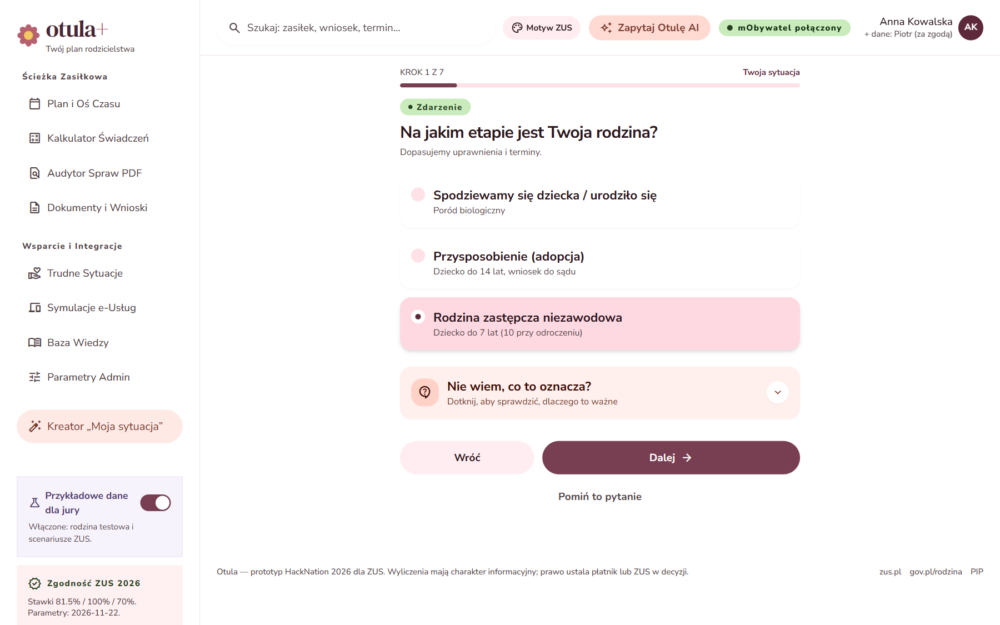

### B3. Zadłużenie składkowe — PASS (symulacja)

**W zadaniu:** wyświetlić stan zadłużenia na dzień powstania prawa do świadczenia, co jest ważne zwłaszcza przy JDG. Wystarczy symulacja zaświadczenia i kwoty.

**Jak to rozwiązaliśmy:** Otula generuje zaświadczenie z numerem, stanem na dany dzień i rozbiciem na FUS oraz Fundusz Pracy. Porównuje zaległość z progiem 1% płacy minimalnej (48,06 zł). Jeśli próg jest przekroczony, informuje, że zasiłek zostanie wypłacony po spłacie całości i że na spłatę jest 6 miesięcy. Przycisk „Uwzględnij w kalkulatorze” od razu przenosi kwotę do wyliczeń.

**Podłączenie prawdziwej usługi:** `GET /api/demo/debt` zastępujemy zapytaniem do systemu rozliczeń ZUS.

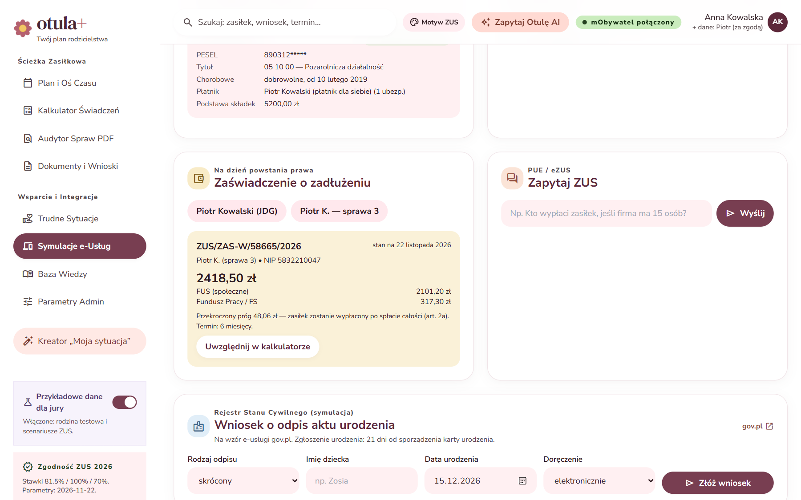

### B4. Podgląd e-ZLA — PASS (symulacja)

**W zadaniu:** symulacja podglądu zaświadczeń lekarskich e-ZLA.

**Jak to rozwiązaliśmy:** lista zwolnień ma numer, okres, lekarza i liczbę dni. Kod „B” jest oznaczony jako 100%. Dni zwolnień wliczają się do licznika okresu zasiłkowego na ekranie planu.

**Podłączenie prawdziwej usługi:** `GET /api/demo/ezla` → rejestr e-ZLA w ZUS.

Zrzut: przy A1 („Podgląd e-ZLA z kodem B”).

### B5. Połączenie z PUE/eZUS — PASS (symulacja)

**W zadaniu:** zasymulować połączenie z PUE/eZUS: zadanie pytania w razie wątpliwości i sprawdzenie danych na koncie.

**Jak to rozwiązaliśmy:** w sekcji „Zapytaj ZUS” rodzic pisze pytanie i dostaje odpowiedź z podstawą prawną. Korespondencja zostaje zapisana w historii. Z Audytora można jednym przyciskiem wysłać przez PUE zapytanie z opisem weryfikowanej sprawy.

**Podłączenie prawdziwej usługi:** `GET/POST /api/pue/messages` → skrzynka PUE/eZUS.

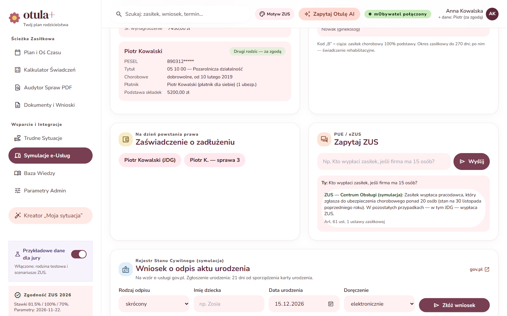

### B6. Wnioski o urlopy i świadczenia — PASS

**W zadaniu:** symulacja wypełnienia wniosków o urlopy i świadczenia i ewentualnego przesłania ich do pracodawcy lub ZUS. Wnioski o urlopy trzeba było zaprojektować samodzielnie.

**Jak to rozwiązaliśmy:** zaprojektowaliśmy generator sześciu wniosków o urlopy na podstawie rozporządzenia Dz.U. 2025 poz. 322:

- urlop macierzyński i rodzicielski w pełnym wymiarze,
- część urlopu rodzicielskiego,
- urlop ojcowski,
- przejęcie części urlopu macierzyńskiego,
- łączenie urlopu rodzicielskiego z pracą,
- uzupełniający urlop macierzyński.

Wniosek wypełnia się sam danymi z kalkulatora i ma treść z podstawą prawną. Można go wydrukować albo „wysłać”. Wysłany dostaje numer i trafia na listę „Przekazane wnioski”. Do wniosku o świadczenie prowadzimy do formularza ZAM na zus.pl.

**Podłączenie prawdziwej usługi:** `POST /api/applications` → wysyłka do PUE/eZUS albo do systemu kadrowego pracodawcy.

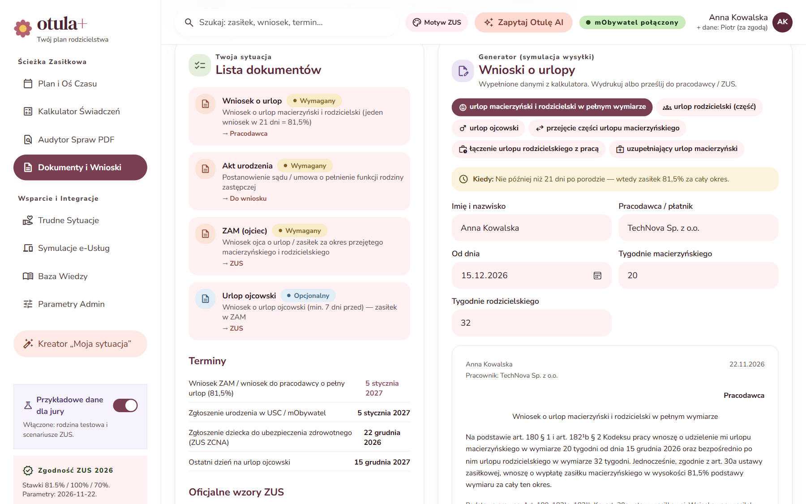

### B7. Odpis aktu urodzenia — PASS (symulacja)

**W zadaniu:** symulacja wniosku o odpis zupełny lub skrócony aktu urodzenia.

**Jak to rozwiązaliśmy:** formularz wzorowany na e-usłudze gov.pl pozwala wybrać odpis skrócony, zupełny albo wielojęzyczny i sposób doręczenia (elektronicznie albo pocztą). Po złożeniu wniosek dostaje numer. Dodajemy też informację, że ZUS pobiera dane o urodzeniu z rejestru PESEL, więc odpisu zwykle nie trzeba dołączać do ZAM.

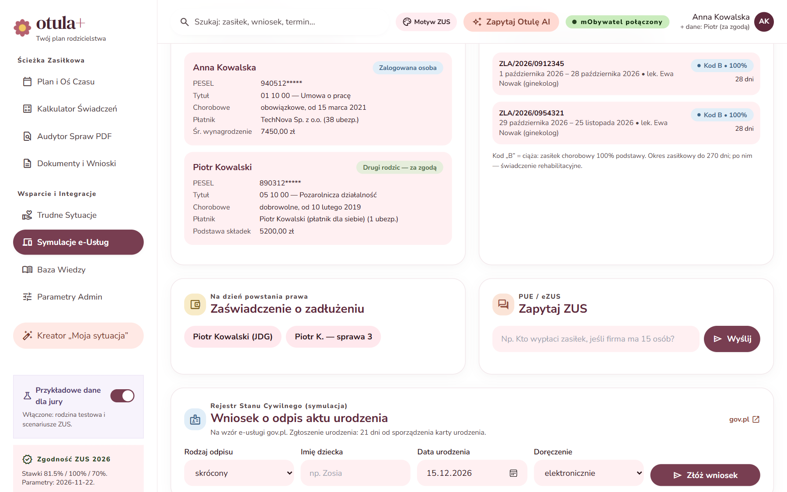

### B8. Podmioty udzielające wsparcia — PASS

**W zadaniu:** informacje o fundacjach, stowarzyszeniach itp., które pomagają np. po śmierci dziecka.

**Jak to rozwiązaliśmy:** opisane przy A9. Ekran „Trudne sytuacje” łączy uprawnienia, dokumenty i organizacje pomocowe w jednym miejscu.

### B9. Przekierowania do oficjalnych źródeł — PASS

**W zadaniu:** odesłania do informacji o rodzicielstwie na stronach ZUS, Ministerstwa Rodziny, Pracy i Polityki Społecznej oraz Państwowej Inspekcji Pracy.

**Jak to rozwiązaliśmy:** w Bazie wiedzy jest sekcja „Przekierowania” z linkami do:

- zus.pl (zasiłek macierzyński i wzory formularzy),
- gov.pl/web/rodzina (urlop rodzicielski),
- pip.gov.pl (rodzicielstwo),
- gov.pl (Rejestr Stanu Cywilnego).

Linki do ZUS, MRPiPS i PIP są też w stopce każdej strony.

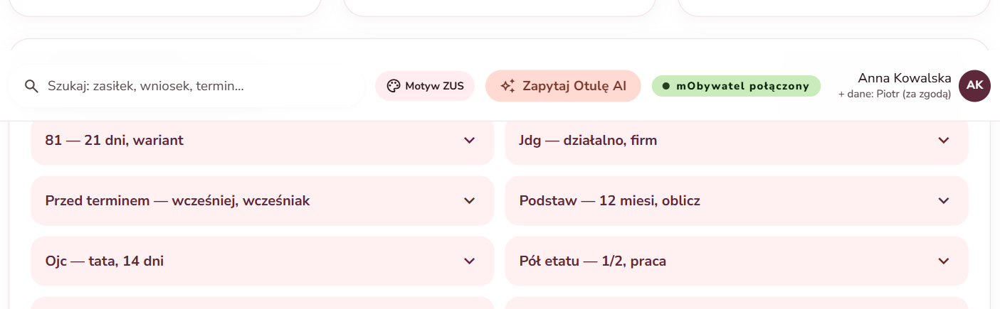

### B10. Panel administracyjny parametrów — PASS

**W zadaniu:** możliwość zmiany parametrów (np. stopy procentowej zasiłku, maksymalnego wymiaru) w panelu administracyjnym, na wypadek zmian w przepisach.

**Jak to rozwiązaliśmy:** w panelu można zmieniać:

- wszystkie stawki (100%, 70%, 81,5%, ojcowski, uzupełniający),
- wymiary urlopów dla 1–5 dzieci,
- wymiary „Za życiem”, liczbę tygodni nieprzenoszalnych i obowiązkowych,
- płacę minimalną, kwotę świadczenia rodzicielskiego, procent składek i maksymalną podstawę dobrowolną.

Zmiana idzie przez `PUT /api/rules`. Serwer ją waliduje (np. stawka musi być z zakresu 0–100%), nadaje nową wersję i zapisuje wpis w dzienniku zmian. Przycisk „Przywróć ustawowe” cofa wszystko do wartości z ustawy. Kalkulator od razu liczy według nowych parametrów, bez zmian w kodzie.

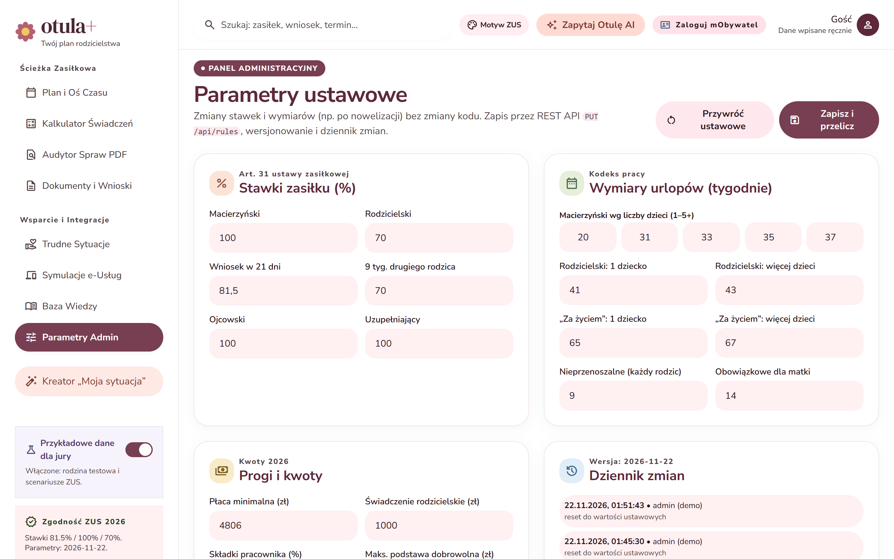

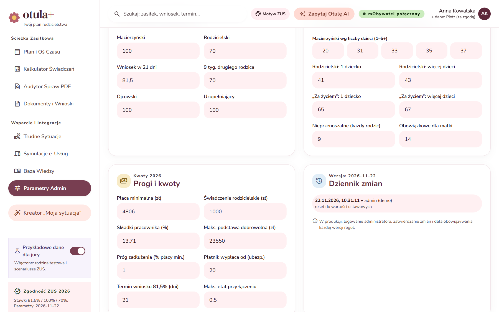

---

## C. Wymagania techniczne i sposób testowania

### C1. Aplikacja webowa RWD — PASS

Każdy ekran ma układ na telefon, tablet i komputer — projektowaliśmy go dla szerokości od 360 px (telefon) do 1440 px (laptop). Na telefonie menu boczne zamienia się w dolny pasek nawigacji, a oś czasu w pionową listę etapów. Asystent jest wtedy pływającym przyciskiem.

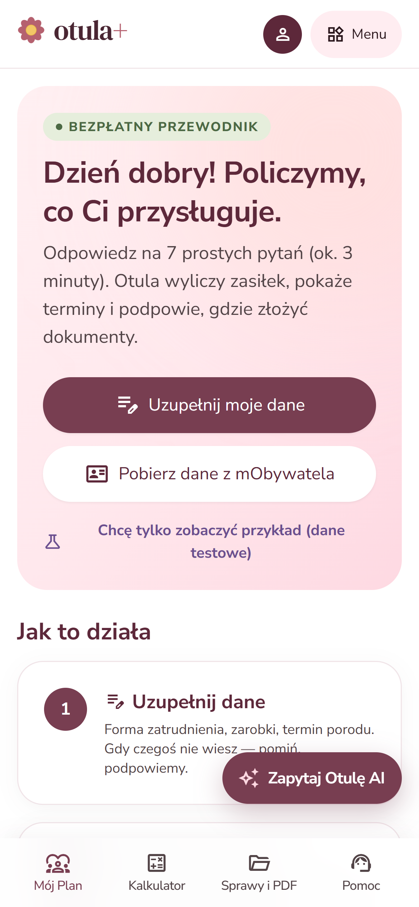 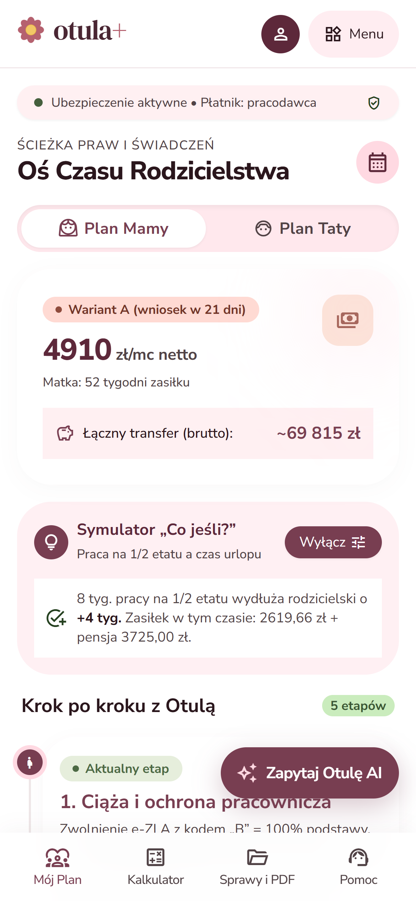 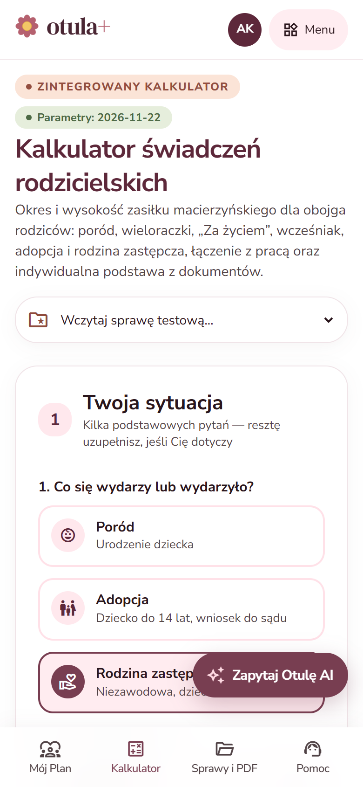

### C2. React, JavaScript na backendzie, REST API — PASS

- **Frontend:** React 18, Vite, Tailwind CSS. Brief preferował React/Next.js.
- **Backend:** Node.js i Express. Brief wymieniał JavaScript jako jedną z preferowanych technologii.
- **Integracja:** REST API: `/api/calculate`, `/api/cases`, `/api/audit`, `/api/rules`, `/api/ask`, `/api/demo/*`, `/api/applications`, `/api/pue/messages`, `/api/health`.

### C3. Potencjał wdrożenia produkcyjnego — PASS

Reguły zasiłkowe są w jednym module (`shared/engine.js`), oddzielone od interfejsu. Ten sam kod liczy na serwerze i w przeglądarce. Parametry ustawowe trzymamy w danych, nie w kodzie. Wszystkie symulowane usługi (mObywatel, ZUS, e-ZLA, PUE, USC) są za REST API, więc wdrożenie oznacza wymianę endpointów, a nie przepisywanie aplikacji. Konfiguracja idzie przez zmienne środowiskowe (`PORT`, `OPENROUTER_API_KEY`, `APP_URL`), a uruchomienie produkcyjne to `npm ci && npm run build && npm start`.

### C4. Upload albo wybór wniosków na stronie — PASS

W Audytorze można przeciągnąć dowolny PDF z zestawów ZUS albo kliknąć jedną z siedmiu spraw testowych:

- wypłata w wariancie 81,5%,
- pozorność umowy,
- zaległość przy JDG,
- wcześniak z „Za życiem”,
- brak ubezpieczenia,
- przysposobienie,
- praca na pół etatu.

Zrzut przy A6.

### C5. Poprawność wyliczeń — PASS

Silnik reguł sprawdza 12 testów automatycznych (`npm test`): reguły zasiłkowe, odczyt PDF (podstawa, kod tytułu, PESEL) i asystenta. Wszystkie przechodzą. Przy każdym wyniku Otula pokazuje, z czego wynika kwota. Przykład dla rodziny testowej: 7 450 zł brutto minus 13,71% składek daje podstawę 6 428,60 zł. Przy 81,5% to 5 239,31 zł brutto, czyli 4 910 zł netto miesięcznie.

---

## D. Wymagania formalne

| Nr | Wymaganie | Co przekazujemy | Wynik |
|---|---|---|---|
| D1 | Tytuł i szczegółowy opis | „Otula+ — Zasiłkowy Przewodnik Przyszłego Rodzica”; opis projektu, `README.md`, ten dokument | **PASS** |
| D2 | Prezentacja do 10 slajdów | 9 slajdów (PPTX i PDF) z notatkami prelegenta | **PASS** |
| D3 | Film do 3 minut | 2 min 52 s, z napisami (.srt) i plakatem; link w zgłoszeniu | **PASS** |
| D4 | Repozytorium kodu | https://github.com/Wolowicz/Zasilkowy-Przewodnik-Przyszlego-Rodzica | **PASS** |
| D5 | Zrzuty ekranu | 33 zrzuty w `docs/img` oraz w prezentacji | **PASS** |
| D6 | Demo jako strona z możliwością testu przykładów | Aplikacja webowa z Audytorem (upload PDF i wybór spraw) oraz kalkulatorem; adres wersji online podajemy w zgłoszeniu | **PASS** |
| D7 | Pełna responsywność | Opisane w C1 | **PASS** |
| D8 | Materiały graficzne | Logo Otula+, plakat filmu, prezentacja, motyw graficzny oraz przełącznik „Motyw ZUS” | **PASS** |
| D9 | Wskazanie funkcji z AI | Opis poniżej, sekcja „Gdzie Otula używa AI” w aplikacji, oznaczenia w interfejsie | **PASS** |

### D9. Gdzie działa sztuczna inteligencja — PASS

Brief prosi, żeby wprost wskazać funkcje oparte na AI. W aplikacji oznaczamy je etykietami („OCR”, „Model AI + przepisy”), a pełny opis jest w Bazie wiedzy:

- **Odczyt skanów w Audytorze:** OCR Tesseract (sieć LSTM, model języka polskiego) działa w przeglądarce, więc plik nie opuszcza urządzenia.
- **Asystent „Zapytaj Otulę”:** najpierw dopasowuje pytanie do bazy przepisów z podstawą prawną. Jeśli skonfigurowano klucz OpenRouter, model AI formułuje odpowiedź wyłącznie na podstawie dopasowanych przepisów. Bez klucza działa sama baza reguł. Pod polem pytania jest ostrzeżenie, żeby nie wpisywać danych osobowych.
- **Kalkulator i weryfikacja uprawnień:** tu AI celowo nie używamy. Wyniki liczy deterministyczny silnik reguł, żeby były powtarzalne i sprawdzalne.
- **Tworzenie projektu:** kod i treści przygotowaliśmy ze wsparciem asystentów AI, a przepisy weryfikowaliśmy w materiałach ZUS.

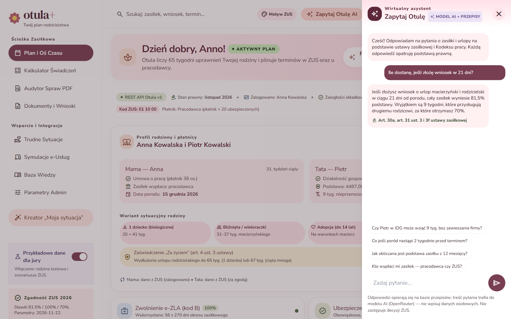

---

## E. Sytuacje z opisu problemu

### E1. Sytuacje szczególne — PASS

W opisie problemu ZUS wymienia trudności w ustalaniu uprawnień przy martwym urodzeniu, wcześniaku, ciężkiej chorobie albo śmierci matki. Każdej z tych sytuacji poświęciliśmy osobną kartę z przepisem, faktami, krokami i dokumentami:

- **Urodzenie martwego dziecka lub zgon dziecka:** 8 tygodni zasiłku, a przy zgonie po 8. tygodniu życia 7 dni.
- **Wcześniak lub hospitalizacja noworodka:** urlop uzupełniający do 8 albo 15 tygodni.
- **Ciężka choroba dziecka („Za życiem”):** rodzicielski 65 albo 67 tygodni.
- **Hospitalizacja, choroba lub śmierć matki:** ojciec przejmuje urlop przed upływem 14 tygodni.

Przy kartach, które da się policzyć, jest przycisk otwierający kalkulator z ustawionym scenariuszem.

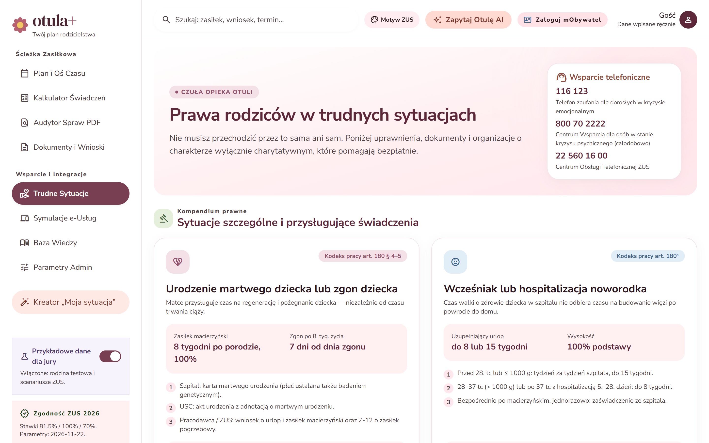

### E2. Szczególna ochrona pracownic i pracowników — PASS

Brief poświęca osobny punkt ochronie z Kodeksu pracy. U nas to pozytywna pozycja na liście ryzyk dla osób na umowie o pracę. Od złożenia wniosku o urlop do jego końca pracodawca nie może wypowiedzieć umowy (art. 177 Kp), a umowa terminowa trwająca ponad miesiąc przedłuża się do dnia porodu. Zaznaczamy też, że ta ochrona nie obejmuje zlecenia ani JDG. Przypomnienie jest również pod listą terminów na ekranie planu.

### E3. Zmiany formularzy od 24.10.2026 — PASS

Przypisy w briefie mówią, że ZUR i ZAO zostały połączone z formularzem ZAM, a Z-3b zlikwidowano. Uwzględniliśmy to w liście dokumentów i wzorach: ZAM jest opisany jako wniosek obejmujący także rodzicielski i ojcowski, a Otula nie każe składać osobnych ZUR ani ZAO.

---

*Dane w scenariuszach są fikcyjne. Wyniki Otuli mają charakter informacyjny i nie zastępują decyzji ZUS.*
